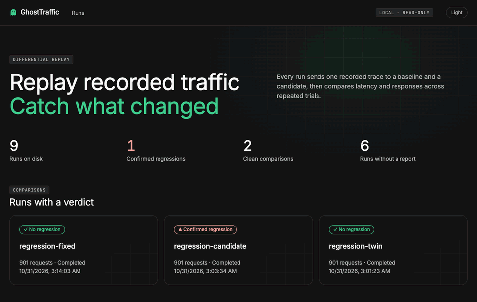
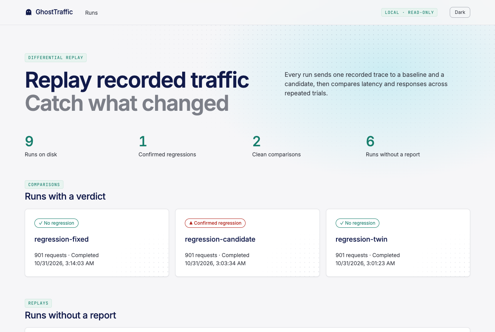
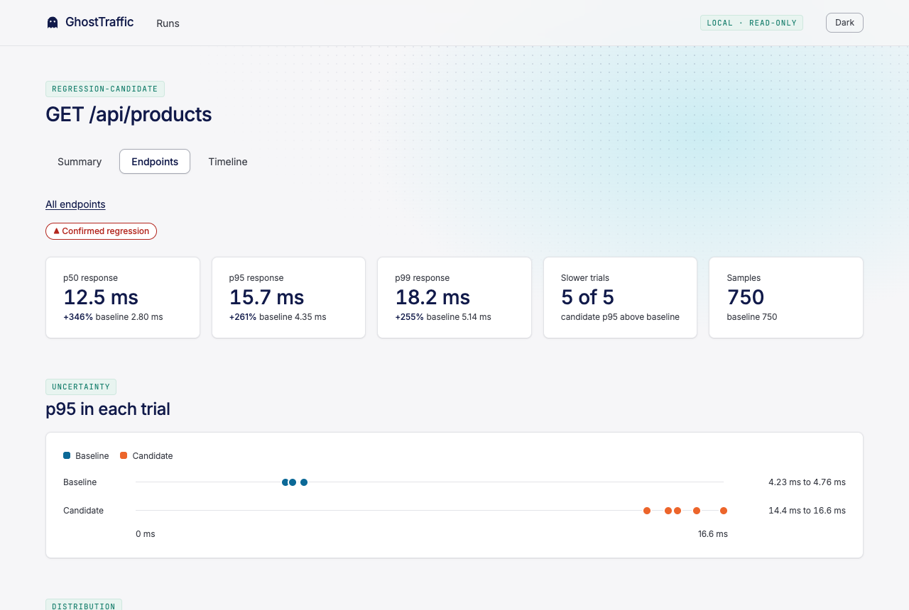

# GhostTraffic

**Find out whether your new backend version got worse before you ship it.**

GhostTraffic records HTTP traffic, replays it against your current version and your new
version, and tells you what changed: slower endpoints, new errors, and different responses.
It runs on your own machine. There is no account, no hosted service, and nothing to add to
your code.



The repo includes a small fake shop to prove it works. From one recording, GhostTraffic stays
quiet on identical code, catches a deliberately slow query on the right endpoint, and clears
the repaired version. The demo fails if any of those answers change.

## How it works

1. **Record.** GhostTraffic sits in front of your service as a proxy and saves each request,
   with secrets removed.
2. **Replay.** It sends those requests, with their original timing, to a baseline (your current
   version) and a candidate (your new version).
3. **Compare.** It repeats the replay several times, compares speed, errors, and JSON
   responses, and gives each endpoint a verdict.

Use it as a check before a release. It does not monitor live sites, and it can only test
services you can run yourself.

## Try the demo

You need Docker with Compose, Go 1.26+, Python 3.12+, Node 24+, and macOS or Linux.

On macOS, [Colima](https://github.com/abiosoft/colima) provides Docker without Docker Desktop.
Run `colima start` first, and clone the repo inside your home directory.

```sh
git clone https://github.com/Hanart-prog/ghosttraffic.git
cd ghosttraffic
make demo        # About 7 minutes: record, replay, and judge all three scenarios
make dashboard   # Browse the results at http://127.0.0.1:7070, Ctrl-C to stop
make down        # Stop the demo and discard its data
```

The demo uses ports 7070, 8000 to 8003, and 9000, so close anything else using them. Keep the
machine awake while it runs: sleep distorts the timing.

Then open `regression-candidate` in the dashboard, and select `GET /api/products` under
Endpoints to see every trial.

## Reading a verdict

| Verdict | Meaning |
| --- | --- |
| No regression | Below the thresholds, or over them in only a minority of trials |
| Observed regression | Over the thresholds in most trials, but not proven |
| Confirmed regression | Over the thresholds in every trial, with at least 5 trials and every candidate trial above every baseline trial |
| Insufficient samples | A trial had fewer than 100 requests for this endpoint, so speed was not judged |

The thresholds are a p95 at least 1.2× baseline and at least 5 ms slower. p95 means 95% of
requests were faster than this. A verdict is evidence of a difference, not of its cause.

The verdict covers speed. Status and JSON differences are listed separately under Response
differences, so check those even when the verdict is clean.

Every number in the dashboard comes from the run's own report. The theme follows your system,
and the switch in the top bar overrides it.

| Runs | Endpoint, with p95 for each trial |
| --- | --- |
|  |  |

## Use it on your own service

You need both versions of your service running at once, on separate ports, each with its own
database. The examples use port 8000 for the baseline and 8001 for the candidate. Use a test
environment and synthetic traffic, never production.

**1. Build the tool.** This needs Go. The dashboard in step 5 also needs Node.

```sh
make build
```

**2. Record.** Start the proxy, send traffic to port 9000 instead of 8000, then press Ctrl-C.

```sh
bin/ghosttraffic capture --listen 127.0.0.1:9000 --upstream http://localhost:8000 --out traces/my-service.jsonl
```

Aim for at least 100 requests per endpoint in the recording, or those endpoints come back as
insufficient samples.

**3. Check the recording.**

```sh
bin/ghosttraffic validate --trace traces/my-service.jsonl
```

**4. Replay and report.**

```sh
bin/ghosttraffic replay --trace traces/my-service.jsonl \
  --baseline http://localhost:8000 --candidate http://localhost:8001 \
  --trials 5 --warmup 200 --capture-bodies \
  --reset-cmd './restore-my-databases.sh' --out runs/run-001
bin/ghosttraffic report --run runs/run-001
```

`report` prints the verdicts and writes `report.json` and a standalone `report.html` into the
run directory. To fail a CI job, add `--fail-on-regression`: `report` then exits 3 on a confirmed
regression. Other verdicts exit 0, including insufficient samples, so read `.verdict` from
`report.json` if your gate needs to be stricter.

**5. Browse the results.**

```sh
make dashboard
```

### What you need to provide

- **A reset script.** `--reset-cmd` runs before every trial and must restore both targets to
  the same data. `restore-my-databases.sh` above stands for your own script; the one in
  `scripts/` only knows the demo. Replays with more than one trial require it when the traffic
  includes writes.
- **A config file, usually.** Pass `--config` to `replay` and `report`.
  `routes` groups URLs such as `/items/1` and `/items/2` into one endpoint, and
  `ignore_json_paths` skips values that always differ, such as generated IDs.
  [`examples/ecommerce/replay.yaml`](examples/ecommerce/replay.yaml) shows both.
- **Workflows, if requests depend on each other.** When a step needs an ID created by an
  earlier step, describe that with `--workflows`. GhostTraffic never guesses these.
  [`make_workflows.py`](examples/ecommerce/make_workflows.py) generates such a file for the
  demo.
- **Optionally, a seed digest.** If `/health` returns JSON with a `seed_digest`, replay refuses
  targets whose digests differ. Without it, you get a warning that equal starting data is
  unknown.

## Troubleshooting

| Problem | Fix |
| --- | --- |
| `make demo` stops with "The stack did not start" | Start Docker. Under Colima, the repo must be inside your home directory |
| A port is already in use | Stop whatever is using it, or run `make down` |
| The dashboard page does not load | `make dashboard` has to stay running in its own terminal |
| A run has no verdict | Build its report: `bin/ghosttraffic report --run runs/<name>` |
| Every endpoint shows insufficient samples | Record more traffic, at least 100 requests per endpoint |
| Requests fail the same way on both targets | They probably use IDs that do not exist on a fresh target. Add a workflow |

## Safety

Replay targets default to loopback and Compose service names. Any other host needs an
explicit `--allow-host` and prints a warning, and sending writes to it also needs
`--allow-external-mutation`. Replay refuses targets reporting different seed state. Only
allowlisted headers are stored, and credentials cannot be allowlisted.

Never point replay at production: it sends real writes, such as placing orders again.

## Why not just a load tester?

A load tester asks how much a backend can take. GhostTraffic is designed to ask whether
a backend still behaves the same under a recorded workload, by combining:

- replay of recorded arrival patterns, with an open-loop schedule that does not hide stalls
- explicit stateful workflows for flows that depend on generated IDs
- differential comparison of status codes, JSON bodies, and latency distributions

## Measured

On one M3 Pro laptop against a trivial local target ([method and limits](docs/benchmarks.md)):

- Replay held 10,000 req/s, the highest rate tested, with p99 scheduling delay of 0.28 ms.
- Capture added about 0.03 ms at the median on one connection, and 0.3 ms at 16.
- A 100,000-result report built in 0.46 s, peaking at 214 MB.

## Development

```sh
make help             # List the main commands
make build            # Build bin/ghosttraffic
make test             # Go tests with the race detector, demo backend tests, dashboard tests
make test-browser     # Dashboard in real Chrome, both themes; needs make demo first
make lint             # gofmt, go vet, staticcheck, ruff, tsc
make bench            # Replay pacing, capture overhead, report cost
make stack            # Start only the demo stack
make replay-demo      # Shorter check of recording and replay accuracy
make workflow-demo    # Checkouts on a target whose generated IDs differ from the recording
make dashboard-docker # Dashboard from a container, without Go or Node
```

## Learn more

- [Architecture and risks](docs/architecture.md)
- [Benchmarks](docs/benchmarks.md)
- [Demo script](docs/demo-script.md)
- [Implementation plan](docs/implementation-plan.md)
- [Limitations](docs/limitations.md)
- [Decision records](docs/adr/)

## License

[MIT](LICENSE)
