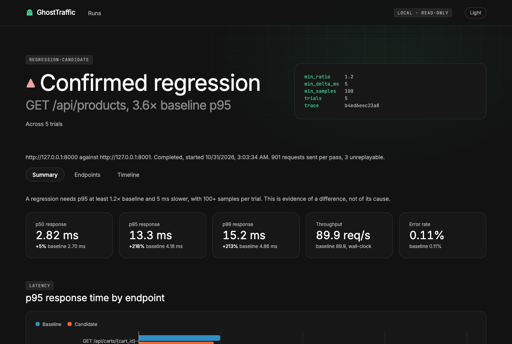

# GhostTraffic

GhostTraffic records HTTP traffic on your laptop, replays it against a baseline and a
candidate backend, and shows evidence of what changed.

One recorded trace, three verdicts: identical code stays quiet, a deliberate N+1 query is
confirmed on the right endpoint, and the repaired version clears. A test fails the demo if
any of that changes.



## Try it

You need Docker with Compose, Go 1.26+, Python 3.12+, and Node 24+. On macOS, Colima provides
Docker without Docker Desktop: run `colima start` first, and keep the repo inside your home
directory.

```sh
make demo        # About 7 minutes: record, replay, and judge all three scenarios
make dashboard   # Browse the results at http://127.0.0.1:7070
make down        # Stop everything and discard its data
```

## Why not just a load tester?

A load tester asks how much a backend can take. GhostTraffic is designed to ask whether
a backend still behaves the same under a recorded workload, by combining:

- replay of recorded arrival patterns, with an open-loop schedule that does not hide stalls
- explicit stateful workflows for flows that depend on generated IDs
- differential comparison of status codes, JSON bodies, and latency distributions

## What the dashboard shows

Every number comes from the run's own report. The theme follows your system,
and the switch in the top bar overrides it.

| Runs | Endpoint, with p95 for each trial |
| --- | --- |
|  |  |

A verdict rests on repeated trials: a confirmed regression needs at least 5 trials, a p95
at least 1.2× baseline and 5 ms slower, and every candidate trial above every baseline
trial. It is evidence of a difference, not of its cause.

## Measured

On one M3 Pro laptop against a trivial local target ([method and limits](docs/benchmarks.md)):

- Replay held 10,000 req/s, the highest rate tested, with p99 scheduling delay of 0.28 ms.
- Capture added about 0.03 ms at the median on one connection, and 0.3 ms at 16.
- A 100,000-result report built in 0.46 s, peaking at 214 MB.

## Using it on your own service

```sh
bin/ghosttraffic capture --listen 127.0.0.1:9000 --upstream http://localhost:8000 --out traces/demo.jsonl
bin/ghosttraffic validate --trace traces/demo.jsonl
bin/ghosttraffic replay --trace traces/demo.jsonl --baseline http://localhost:8000 \
  --candidate http://localhost:8001 --concurrency 50 --speed 1 --out runs/run-001 \
  --trials 5 --warmup 200 --capture-bodies --reset-cmd './restore-my-databases.sh'
bin/ghosttraffic report --run runs/run-001 --format html,json
bin/ghosttraffic serve --runs-dir runs --listen 127.0.0.1:7070
```

`--reset-cmd` runs before every trial and must restore both targets to the same state.
`restore-my-databases.sh` stands for your own script: `scripts/reset-targets.sh` only knows
the demo stack. Point this at services you own, in a test environment, with synthetic traffic.

## Development

```sh
make build            # Build bin/ghosttraffic
make test             # Go tests with the race detector, demo backend tests, dashboard tests
make test-browser     # Dashboard in real Chrome, both themes; needs make demo first
make lint             # gofmt, go vet, staticcheck, ruff, tsc
make bench            # Replay pacing, capture overhead, report cost
make stack            # Start only the demo stack
make replay-demo      # Shorter check of recording and replay accuracy
make workflow-demo    # Checkouts on a target whose generated IDs differ from the recording
make dashboard-docker # Dashboard from a container, without Go or Node
```

## Safety

Replay targets default to loopback and Compose service names. Any other host needs an
explicit `--allow-host` and prints a warning, and sending writes to it also needs
`--allow-external-mutation`. Replay refuses targets reporting different seed state. Only allowlisted headers are stored, and
credentials cannot be allowlisted. Use synthetic traffic only, and never point replay
at production: it sends real mutating requests.

## Learn more

- [Architecture and risks](docs/architecture.md)
- [Benchmarks](docs/benchmarks.md)
- [Demo script](docs/demo-script.md)
- [Implementation plan](docs/implementation-plan.md)
- [Limitations](docs/limitations.md)
- [Decision records](docs/adr/)

## License

[MIT](LICENSE)
