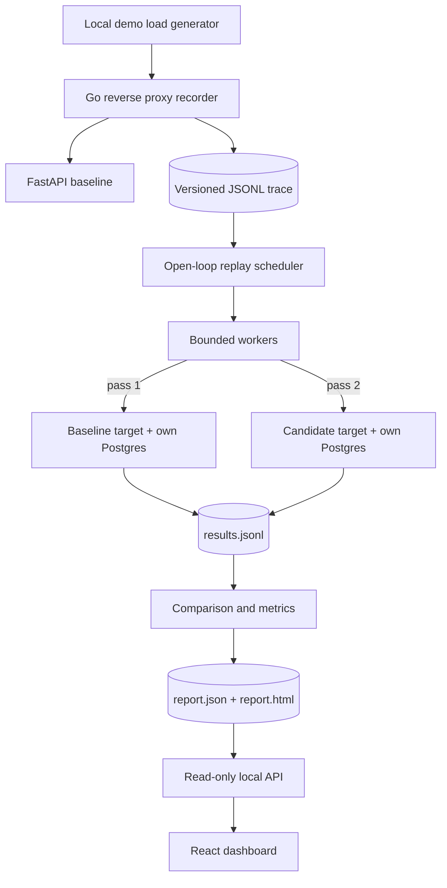

# Architecture

GhostTraffic records an HTTP workload, replays it against two isolated backends, and
compares what came back. This diagram shows the design; the table below shows what
exists today.

## Status

| Component | Path | Status |
| --- | --- | --- |
| CLI shell, flag validation, signals | `cmd/ghosttraffic` | Built. `capture` and `validate` work; other engine commands exit 1 with "not implemented yet" |
| Config, safety defaults, target checks | `pkg/config` | Built |
| Artifact decoding rules | `internal/schema` | Built |
| Trace format, validation, reader, writer | `internal/trace` | Built |
| Outbound HTTP guard | `internal/egress` | Built; used by capture |
| Result format, stats, verdicts | `internal/metrics` | Built; report wiring Phase 3 |
| Run and report formats | `internal/report` | Formats built, generation Phase 3 |
| Demo stack | `docker-compose.yml`, `examples/ecommerce` | All shop routes, load generator, independent trace verifier. All variants identical until Phase 3 |
| Recorder | `internal/capture` | Built |
| Replay engine | `internal/replay` | Scheduler and seed preflight built; request sending Phase 2 |
| Comparison | `internal/compare` | Classification built; canonical JSON Phase 3 |
| Workflows | `internal/workflow` | Phase 4 |
| API and dashboard | `internal/server`, `web/` | Phase 5 |

## Artifacts

| File | Written by | Contents |
| --- | --- | --- |
| `*.jsonl` trace | capture | One sanitized request per line, with relative arrival offset |
| `run.json` | replay | Run manifest: trace hash, config, sanitized targets, build, status |
| `results.jsonl` | replay | One line per attempt, keyed by `(trial, target, request_id)` |
| `report.json` | report | Deterministic aggregates derived only from `results.jsonl` |

## Design rules

- Results join on logical request IDs, never on runtime IDs or completion order.
- Every scheduled request gets exactly one terminal result, including drops.
- Goroutines, queues, and captured bodies all have explicit bounds.
- Absent evidence reads as "not available", never as a match.

## Key risks

Capture runs on the egress and sanitizing safeguards today. The rest are tested
libraries that protect real traffic once the replay and report engines call them.

| Risk | Safeguard | Still open |
| --- | --- | --- |
| **Coordinated omission** hides the stalls this tool exists to find | Open-loop `replay.Schedule`; `metrics.Stats` keeps service time, response time, and delay, and keeps timeouts in the tail | Accuracy under real load is unmeasured |
| **False agreement** from recorded IDs that do not exist on a fresh target | `both_failed` and `body_unavailable` classes with warnings; seed digest preflight | Workflows (Phase 4) fix the cause; this only exposes it |
| **Measurement noise** on one shared laptop | `metrics.Assess` sample gate and verdicts; `replay.TargetOrder` alternation | Warmups and multi-trial runs are not wired up; effects smaller than the noise stay undetectable |
| **Unsafe egress or leaked secrets** | `internal/egress` dial check, no redirects, no proxies, boundary test; `internal/capture` redaction; wider header denylist | Residual risks in [ADR 0005](adr/0005-traffic-safety.md) |
| **Replayer as bottleneck** | `CappedTee`; bounded workers and queue with explicit drops; per-target delay and warnings | Replayer's own capacity is unbenchmarked (Phase 6) |

Decisions are recorded in [docs/adr](adr/), and phase deliverables in the
[implementation plan](implementation-plan.md).
