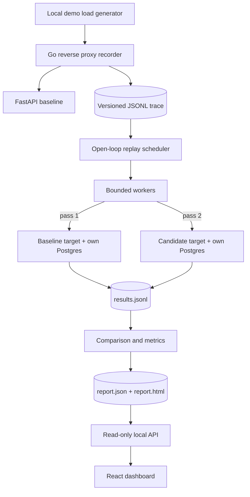

# Architecture

GhostTraffic records an HTTP workload, replays it against two isolated backends, and
compares what came back. This diagram shows the design; the table below shows what
exists today.

## Status

| Component | Path | Status |
| --- | --- | --- |
| CLI shell, flag validation, signals | `cmd/ghosttraffic` | Built |
| Config, safety defaults, target checks | `pkg/config` | Built |
| Artifact decoding rules | `internal/schema` | Built |
| Trace format, validation, reader, writer | `internal/trace` | Built |
| Outbound HTTP guard | `internal/egress` | Built; used by capture and replay |
| Results, endpoint routing, stats, verdicts | `internal/metrics` | Built |
| Report building | `internal/analysis` | Built |
| Report formats, HTML page | `internal/report` | Built |
| Demo stack | `docker-compose.yml`, `examples/ecommerce` | Baseline, candidate with a deliberate N+1 query, repaired version, baseline twin, and independent verifiers |
| Recorder | `internal/capture` | Built |
| Replay engine | `internal/replay` | Built, including trials, warmup, and reset |
| Comparison | `internal/compare` | Built |
| Workflows | `internal/workflow` | Built |
| Benchmarks | `tests/benchmark` | Built; results in [benchmarks.md](benchmarks.md) |
| Browser tests | `web/e2e` | Built; run in CI on real demo runs |
| API and dashboard | `internal/server`, `web/` | Built |

## Artifacts

| File | Written by | Contents |
| --- | --- | --- |
| `*.jsonl` trace | capture | One sanitized request per line, with relative arrival offset |
| `run.json` | replay | Run manifest: trace hash, config, sanitized targets, build, status |
| `results.jsonl` | replay | One line per attempt, keyed by `(trial, target, request_id)` |
| `report.json` | report | Deterministic aggregates derived only from `results.jsonl` |

## Design rules

- Results join on logical request IDs, never on runtime IDs or completion order.
- Every scheduled request gets exactly one terminal result, including drops.
- Goroutines, queues, and captured bodies all have explicit bounds.
- Absent evidence reads as "not available", never as a match.

## Key risks

Capture, replay, and reports all run on these safeguards today.

| Risk | Safeguard | Still open |
| --- | --- | --- |
| **Coordinated omission** hides the stalls this tool exists to find | Open-loop `replay.Schedule`; `metrics.Stats` keeps service time, response time, and delay, and keeps timeouts in the tail | Accuracy under real load is unmeasured |
| **False agreement** from recorded IDs that do not exist on a fresh target | Explicit workflows; `both_failed` and `body_unavailable` classes with warnings; seed digest preflight | Requests outside a workflow keep recorded IDs |
| **Measurement noise** on one shared laptop | Warmups, repeated trials with resets, target-order alternation, sample gate, and a demo that must stay quiet on identical code | Effects smaller than the noise stay undetectable |
| **Unsafe egress or leaked secrets** | `internal/egress` dial check, no redirects, no proxies, boundary test; `internal/capture` redaction; wider header denylist | Residual risks in [ADR 0005](adr/0005-traffic-safety.md) |
| **Replayer as bottleneck** | `CappedTee`; bounded workers and queue with explicit drops; per-target delay and warnings | Replayer's own capacity is unbenchmarked (Phase 6) |

Decisions are recorded in [docs/adr](adr/), and phase deliverables in the
[implementation plan](implementation-plan.md).
